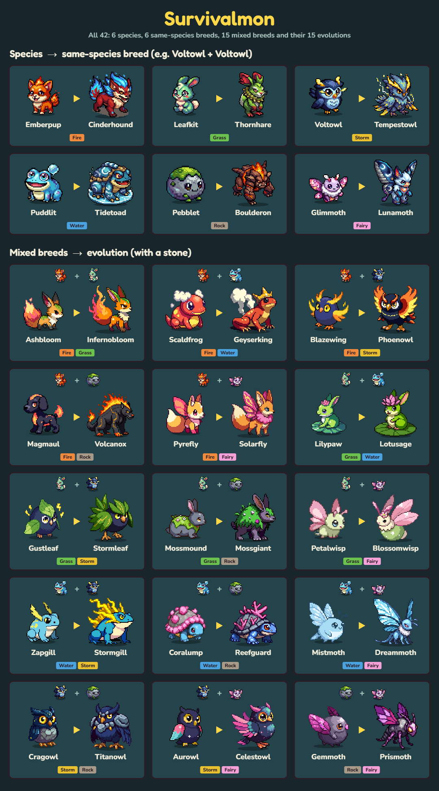

# Survivalmon

A cozy pixel-art survival roguelite with a creature-collector twist. Runs start just **20 seconds**
long: every monster you defeat pays coins, and when the timer runs out you're back in **town**.
Spend the coins in the **Training Hall** (run time, HP, damage, speed…) and head out again for a
longer, stronger run, up to the full **8 minutes**: King Slime around 2:00, the Treant around 4:00,
the Colossus around 6:00, and the Night Lord for the last 30 seconds. During a run you
level up, duck into houses (the clock stops inside!) for **weapons, spells, artifacts and eggs**,
discover **combos**, and fight beside a team of survivalmons.

The full design (buildings, breeding, skill tiers, gear) is in the design doc;
`PLAN.md` covers the original build.

## Play

**https://harel-ben-or.github.io/survivalmon/**

On an Android phone, open it in Chrome and choose **Install app** (or ⋮ → *Add to Home screen*).
It installs like a normal app: its own icon, full screen and landscape, and it updates itself
whenever new code is pushed here. After one full load it also starts with no connection.

Run it locally with `npm run dev` (http://localhost:5173). There's no build step.



## Town

- Walk with WASD / arrows or the joystick; stand at a door and press **E** (or tap **!**).
- **Enter the Wild** (the gate): pick your hero and drag survivalmons into your team, then *Let's run to the wild!*
- **Training Hall**: hero upgrades bought with banked coins, including run time (up to 8:00).
- **Ranch**: every survivalmon you own roams the pasture. Train them (they gain EXP while you're away),
  free copies for species coins, and spend those on species upgrades.
- **Hatchery**: 3 nests. Eggs hatch after time spent in the wild. Breed two survivalmons (Lv 5+, both are
  used up) into an egg of their breed: same species gives its grown-up form, two species one of 15 mixes.
- **Clinic**: heal survivalmons hurt or fainted in a run (resting a run also heals them).
- **Survidex**: all 42 survivalmons and breeds, and breeding recipes you've found.
- **Spirit Shrine**: upgrades for every survivalmon, and timed research that improves skill tier odds.
- **Workshop**: each hero's 6 gear slots (gear drops in runs) and their levels; set and level bonuses.
- **Merchant**: items for your next run.
- Every building has levels (coins + wood, stone, clay and iron gathered in runs).

## Survivalmons

- You start by choosing 1 of 5 eggs; it hatches after a minute in the wild. After that, a **wild
  survivalmon** turns up now and then: defeat it within 25 s to catch it. Monsters are never caught.
- Each one has its species' unique skill (an attack) and a random passive skill, each with a tier
  (D 65%, C 20%, B 10%, A 4%, S 1%). They fight with their own HP; fainted ones stay home until healed.
- Mixed breeds evolve at Lv 10 with an evolution stone of either parent's type.

## Run it

```bash
npm run dev
```

Then open http://localhost:5173. No install step — it's plain JavaScript with zero dependencies
(Node is only used for the tiny static server in `server.js`).

## Play on your phone

1. Start the server on your PC (`npm run dev`). It prints a line like
   `On your phone (same Wi-Fi): http://10.100.102.42:5173`.
2. Open that address in your phone's browser (phone and PC on the same Wi-Fi).
   The first time, Windows may ask whether Node.js can use the network — allow it on private networks.
3. Hold the phone sideways. Touch controls switch on automatically:
   drag on the left half to move; on the right are **DASH**, the **!** action button
   (enter houses / search) and your spell icons; **II** pauses.
4. For a full-screen app icon: Android — the game goes fullscreen when you pick a hero;
   iPhone — Share → **Add to Home Screen**.

The **Controls** button on the title screen switches between Auto / Touch / Keyboard.

## Controls

| Key | Action |
|---|---|
| WASD / Arrows | Move |
| Space | Dash |
| E | Enter a building or house / search / take loot |
| 1 · 2 · 3 | Cast spells |
| Esc / P | Pause (in a run) or the town menu |
| M | Mute |

See [PLAN.md](PLAN.md) for the full design, content lists and roadmap.

## Where things live

- `src/content/` — all game data: heroes, weapons, spells, artifacts, combos, pets, monsters, waves.
  Tweak numbers here to rebalance.
- `assets/sprites/` — all PixelLab art. Replace a file with the same name to change a sprite:
  - `heroes/<id>/<direction>.png` (8 directions) and `heroes/<id>/walk/<direction>_<frame>.png` (walk cycles, counts in `walk/frames.json`)
  - `creatures/<id>.png` — critters, monsters, evolved forms, bosses
  - `tiles/` — ground tilesets (grass, dirt, stone, farm, water, dark grass) with `tiles.json`
  - `world/` — trees, houses, barn, shrine, props; `decals/` — flowers, tufts, crops, lily pads
  - `town/` — the town buildings: gate, Training Hall, Clinic, Workshop, Hatchery, Survidex library
  - `interior/` — floors, walls, furniture, chests; `icons/` — items, orbs, stones, pickups; `projectiles/`
- `src/gfx/art.js` — loads that art, draws it at 2× resolution and animates single images in code (hop / walk / fly).
- `src/world/tileground.js` — draws the ground from the tilesets (autotiled terrain edges, cached in chunks).
- `src/gfx/` (other files) — the original code-drawn sprites, used only if a PNG is missing, plus effects.
- `src/content/species.js` — every critter: stats, skills, catch rate, evolution; `src/systems/collection.js` — the saved Ranch (all your survivalmons and the team).
- `src/world/town.js` — the town map, its doors and collision; `src/ui/town_ui.js`, `mons_ui.js`, `shop_ui.js` — the town screens.
- `src/systems/meta.js` — coins, materials, Training Hall, building levels, heroes and gear; `src/systems/shrine.js` — the Spirit Shrine.
- `src/content/skills.js` — skill tiers and passives; `gear.js` — hero boosts, unlocks and gear; `buildings.js` — building levels and Merchant items.
- `src/world/` — map generation, ground painter, house interiors, collision, monster pathing.
- `src/entities/`, `src/systems/` — player, monsters, pets, combat, loot, spawning.
- `src/ui/` — HUD, menus and all modal screens (DOM overlay).
